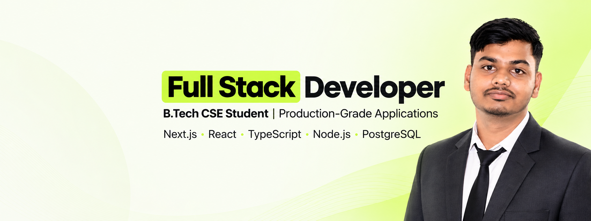

<h1 align="center">Hi , I'm Madhukar</h1>
<h3 align="center">Full-Stack Developer | Backend Engineer | AI-Integrated SaaS Builder</h3>

  

  
  
  
  
  
  
  

---

### ✨ About Me

- **Education:** B.Tech in Computer Science & Engineering @ Maharishi Markandeshwar (Deemed to be University), 2025 – 2028
- **Academic Merit:** Department Topper — Diploma in CSE, Government Polytechnic, Purnea (CGPA 8.43)
- **Hackathons & Honors:** 
  - Top 30 / 150 — PromptWars Hackathon (Kavach AI Safety Platform)
  - Top 5 — Smart Bihar Hackathon, IIT Patna
- **What I'm Building:**
  - **[VelocityAI](https://github.com/Mr-Madhukar/VelocityAI)** ([Live Demo](https://my-ai-code-reviewer.onrender.com)) — Autonomous AI Product Delivery Cockpit & PR Review SaaS (Next.js 16, tRPC v11, Drizzle ORM, Inngest, BetterAuth)
  - **[My Form](https://github.com/Mr-Madhukar/my-form)** ([Live Demo](https://my-form.mrmadhukar.in)) — AI-native conversational form builder SaaS inside Turborepo monorepo
  - **[MailOS](https://github.com/Mr-Madhukar/MailOS-App)** ([Live Demo](https://mailos.mrmadhukar.in)) — Keyboard-first AI command center with pgvector semantic search & Gmail/Calendar OAuth
  - **[Kavach](https://github.com/Mr-Madhukar/Kavach)** ([Live Demo](https://kavach.mrmadhukar.in/)) — AI-powered personal safety companion with Google Gemini distress scoring & Socket.io broadcast
- **Technical Writings:** Author of **[67+ published engineering articles on Medium](https://mrmadhukar.medium.com/)** covering Systems Architecture, DevOps & Linux, Networking, and Next.js / React 19.
- **Focus Areas:** Type-safe full-stack architectures, custom JWT/OAuth auth flows, event-driven pipelines, vector search (pgvector), and autonomous AI agent tooling.
- **Looking For:** Software engineering internships and collaborating on high-impact AI/Full-Stack products.

---

###  Tech Stack

**Programming Languages**

  

**Frontend**

  
  
  
  

**Backend & Architecture**

  
  
  
  
  
  

**Databases**

  
  
  

**AI & LLM Integration**

  
  
  

**DevOps, Tools & Monorepo**

  
  
  

---

<b> GitHub Statistics</b>

 

  
  

  

<i>"Code with passion, build with purpose"</i>

###  Random Dev Quote

  

  

